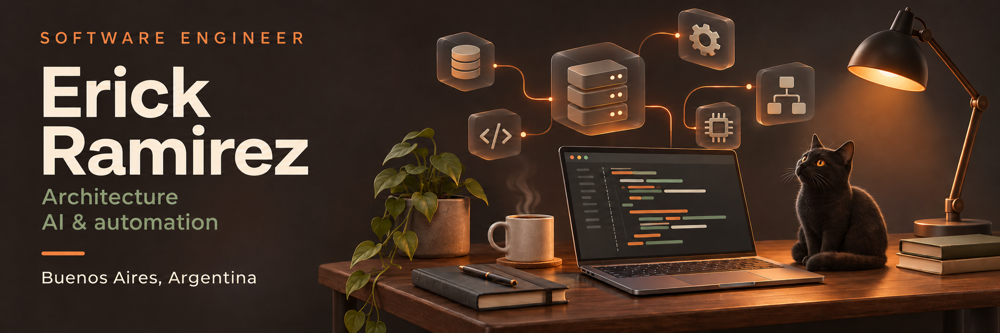
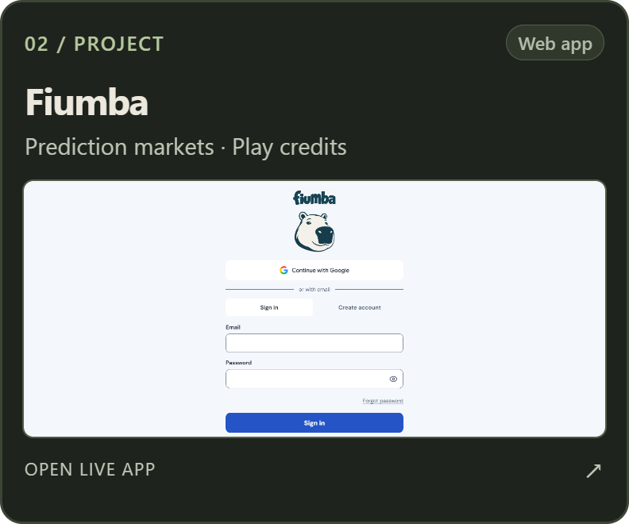

  

  

I'm a **Senior Software Engineer** based in Buenos Aires. I build software products and internal tools, working on architecture, implementation and production support.

I also build AI-assisted development workflows for engineering teams, connecting project context with coding agents and MCP integrations. I help teams adopt them through demos, documentation and technical support.

  <picture>
    <source media="(prefers-reduced-motion: reduce)" srcset="./assets/workflow.png">
    
  </picture>

### Selected projects

  
  
  

  <a href="https://github.com/ErickRRB/Pbeaux">Pbeaux source</a>
  &nbsp; · &nbsp;
  <a href="https://fiumba.bet/">Fiumba live</a>
  &nbsp; · &nbsp;
  <a href="https://github.com/ErickRRB/tizen-tv-home">Quiet Home source</a>

### Stack

  
  
  
  
  
  
  
  

My work also includes AWS, GCP, CI/CD, SQL Server and event-driven systems.

  
More about my background

I've been working in software since 2018, across banking platforms, ERP applications and product engineering. Alongside implementation, I review code, help unblock technical work and coordinate people on larger initiatives.

My current focus is software architecture and AI-assisted engineering, including tools that help teams understand their code and prepare changes for release.

