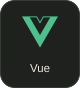
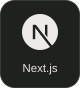
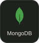
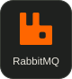
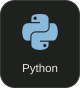
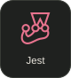
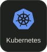
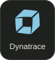

  

  

I'm **Erick**, a software engineer in Buenos Aires. I build apps and tools, and I'm interested in AI agents and ways to make development less repetitive.

I built a development workflow that's now used by **over 30 people**, and created the foundation of an audience and messaging copilot. A few of my projects are below.

  <picture>
    <source media="(prefers-reduced-motion: reduce)" srcset="./assets/workflow.png">
    
  </picture>

### Selected projects

  
  
  

  <a href="https://github.com/ErickRRB/Pbeaux">Pbeaux source</a>
  &nbsp; · &nbsp;
  <a href="https://fiumba.bet/">Fiumba live</a>
  &nbsp; · &nbsp;
  <a href="https://github.com/ErickRRB/tizen-tv-home">Quiet Home source</a>

### Stack

**Languages, services & interfaces**

  
  
  
  
  
  
  
  

**Data, quality & delivery**

  
  
  
  
  
  
  
  

I also work with SQL Server, REST/SOAP APIs, GitLab/GitHub CI/CD and Google Cloud Storage.

  
A little more about me

I've been building software since 2018. My work has taken me through banking apps, ERP systems and airline projects, and I often build tools to take repetitive work off the team's hands.

