

  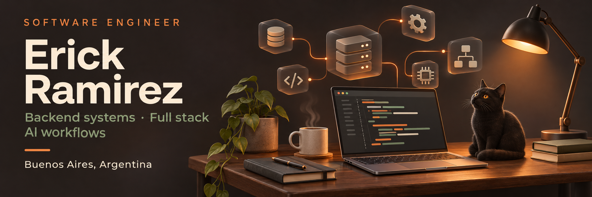

  <a href="https://www.linkedin.com/in/erickrrb/"><strong>LinkedIn ↗</strong></a>
  &nbsp; · &nbsp;
  <a href="#selected-projects">Explore my projects ↓</a>

I'm a **Senior Software Engineer** based in Buenos Aires. I work on backend systems and full stack products, including APIs, microservices and payment integrations, and take work through implementation, deployment and production support.

I also build AI-assisted development workflows for engineering teams, connecting project context with coding agents and MCP integrations. I help teams adopt them through demos, documentation and technical support.

  <picture>
    <source media="(prefers-reduced-motion: reduce)" srcset="./assets/workflow.png">
    
  </picture>

### Selected projects

  <a href="https://pbeaux.com/">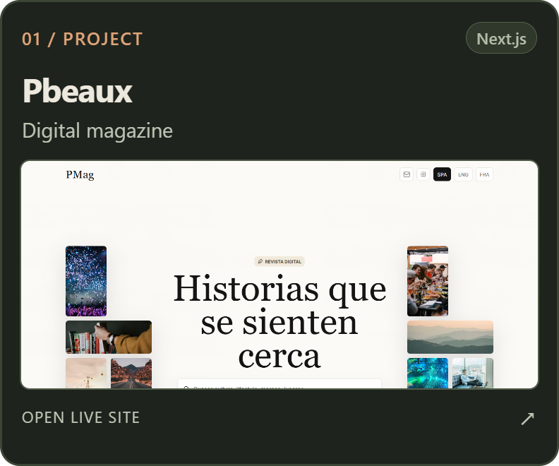</a>
  <a href="https://savings-dashboard.vercel.app/">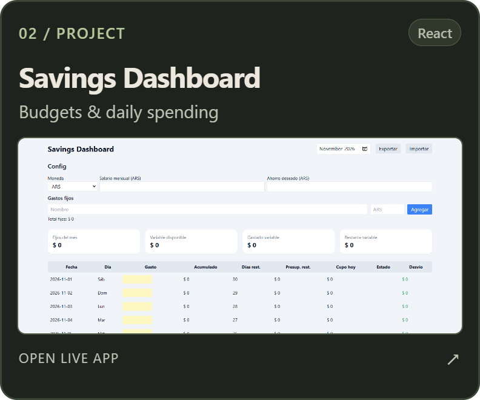</a>
  <a href="https://github.com/ErickRRB/tizen-tv-home">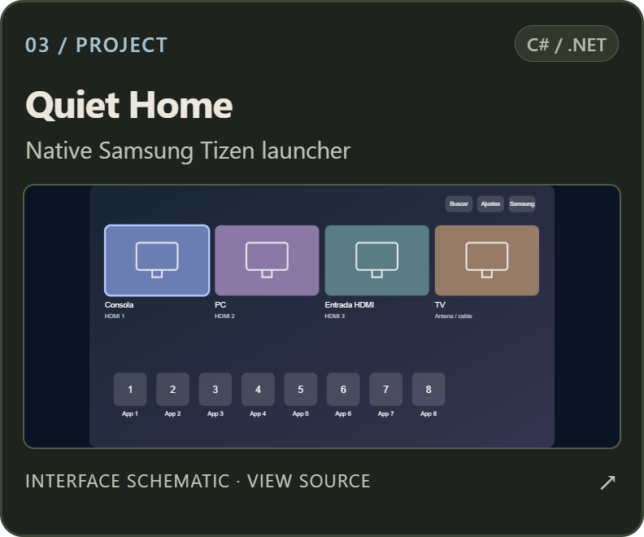</a>

  Source: <a href="https://github.com/ErickRRB/Pbeaux">Pbeaux</a>
  &nbsp; · &nbsp;
  <a href="https://github.com/ErickRRB/SavingsDashboard">Savings Dashboard</a>
  &nbsp; · &nbsp;
  <a href="https://github.com/ErickRRB/tizen-tv-home">Quiet Home</a>

### Stack

  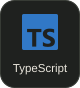
  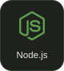
  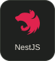
  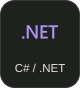
  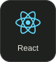
  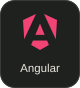
  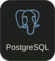
  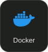

My work also includes AWS, GCP, CI/CD, SQL Server and event-driven systems.

  
More about my background

I've been working in software since 2018, across banking platforms, ERP applications and product engineering. Alongside implementation, I review code, help unblock technical work and coordinate people on larger initiatives.

My current focus combines backend architecture, full stack delivery and tools that help engineering teams understand their code and prepare changes for release.

